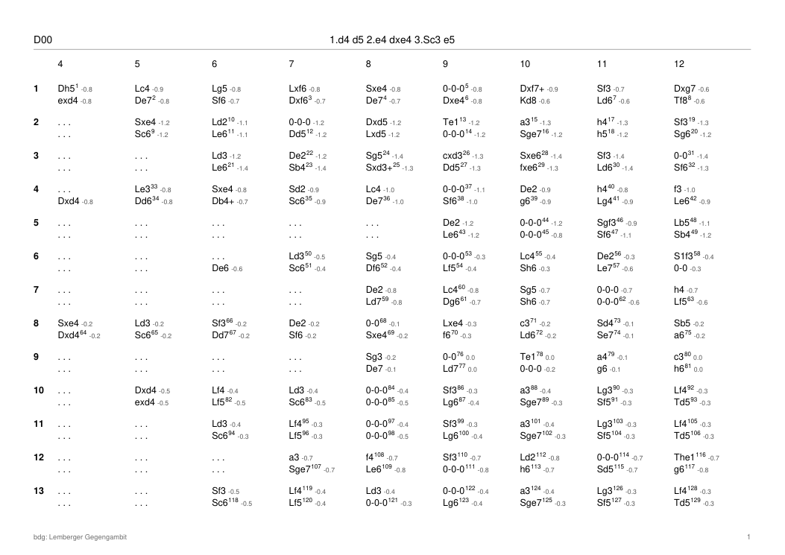
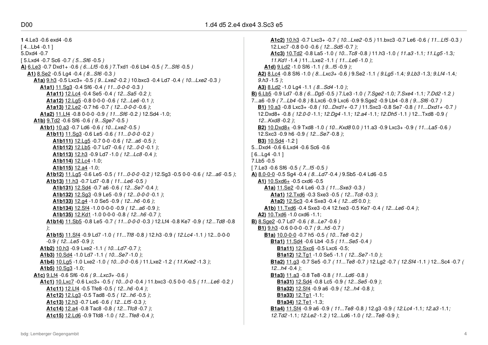

# PGN Repertoire Print

Command-line tool for **Windows and Linux** that prints an analysed PGN opening tree as a
**repertoire PDF in the style of ChessBase**:

- **Overview table** (A4 landscape): one row per main line, one column per full move, White's move
  above Black's. Moves that repeat the row above are shown as `. . .`. The columns always run
  up to a **fixed last move (default 12)**.
- **Footnotes** (two columns): every line that is not a table row, attached as a superscript number
  to the move it is an alternative to. Inside a note, side lines are given as `[ ... ]` blocks.
  Further branchings are labelled `A)`, `A1)`, `A1a)` … and replies that end the line are shown
  inline in italics, `( 12...h6 -0.4 )`.
- **Every move shows its evaluation, rounded to one decimal** (`+0.35` → `+0.4`, `-1.25` → `-1.3`,
  mate `#3`). No other annotation is printed: text comments, `!`/`?` and NAGs are ignored.

Overview table:



Footnotes:



## Input

One PGN game containing the whole tree as nested variations, with the engine evaluation of the
position after each move in the move's comment, White's point of view:

```
1. d4 { +0.30 } d5 { +0.35 } 2. e4 { -0.20 } ( 2. c4 { +0.40 } ) 2... dxe4 { -0.10 } *
```

Accepted evaluation forms: `{ +0.35 }`, `{ -1.30 }`, `{ #3 }`, `{ #-3 }` and `[%eval 0.35]`.
This is the format written by the Stockfish analysis scripts of the
[PGN Tree Viewer](https://github.com/freibauer/pgntreeviewer) (`tools/build_tree.py`).
If the file holds several games, only the first is printed. A `FEN` header is respected for move numbers.

Header line of each page: the `ECO` tag (if present) and the moves common to all lines.
Footer: the `Event` tag (or the file name) and the page number.

## Usage

```
pgnrepertoireprint <input.pgn> [options]

  -o, --output <file.pdf>  output file (default: input name with .pdf)
  --last-move <n>          last move shown in the table (default 12)
  --rows <n>               number of main lines in the overview table (default 30)
  --lang <de|en>           piece letters: de = K D T L S (default), en = K Q R B N
  --title <text>           footer text (default: PGN Event tag or file name)
  --row <moves>            put this line into the table (repeatable), English or German letters
```

Examples:

```
pgnrepertoireprint variante.pgn
pgnrepertoireprint variante.pgn -o repertoire.pdf --rows 20 --lang en
pgnrepertoireprint variante.pgn --row "1.d4 d5 2.e4 dxe4 3.Sc3 e5 4.d5 f5"
```

On Windows you can also drag a PGN file onto `pgnrepertoireprint.exe`; the PDF is written next to it.

### Which lines become table rows?

The first row is the main line (first move of every variation). Each further row opens the
alternative with the most line ends behind it, until `--rows` rows exist. Lines given with `--row` are
added right after the main line. The rows are printed in tree order, and everything else goes into the footnotes. Footnotes are numbered row by row,
move by move, as in ChessBase.

## Download / build

Prebuilt binaries are in `dist/`:

- `dist/pgnrepertoireprint.exe` (Windows x64)
- `dist/pgnrepertoireprint-linux` (Linux x86-64)

To build them yourself (Rust 1.85+, no external crates):

```
rustup target add x86_64-pc-windows-gnu x86_64-unknown-linux-gnu
sudo apt install gcc-mingw-w64-x86-64      # Windows cross linker
./build.sh            # both
./build.sh windows    # or: ./build.sh linux
```

On Windows itself: `cargo build --release`.

The PDF uses the standard PDF fonts Helvetica / Helvetica-Bold / Helvetica-Oblique,
which every PDF viewer provides, so no fonts are embedded and the files stay small.

## License

MIT
